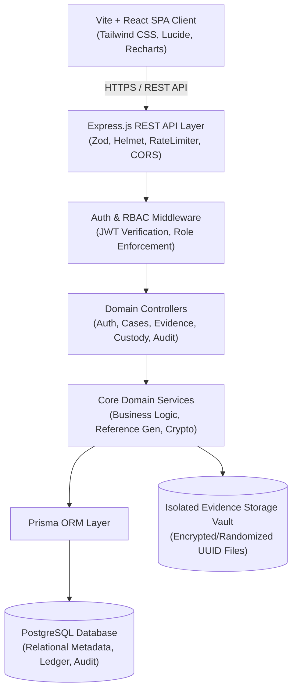
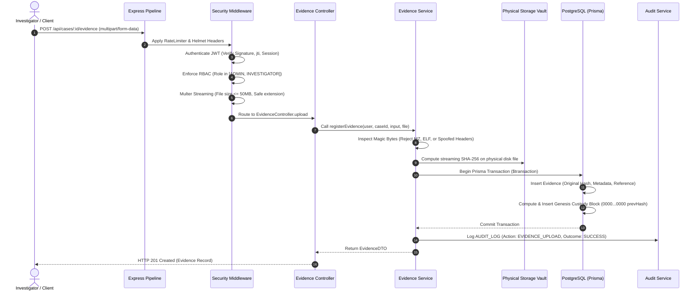

# ICCF System Architecture Documentation

## 1. Executive Architectural Overview

**Integrity & Chain-of-Custody Focused (ICCF)** is an enterprise-grade digital evidence management platform engineered for Digital Forensics and Incident Response (DFIR) practitioners, Security Operations Center (SOC) teams, and compliance auditors.

The system is architected as a high-security, full-stack monorepo with an unyielding emphasis on:

1. **Mathematical Evidence Integrity**: Real-time cryptographic hashing (SHA-256) of ingested artifacts.
2. **Cryptographic Chain of Custody (CoC)**: Append-only hash-linked ledger guaranteeing chronological traceability.
3. **Defense-in-Depth Security Boundaries**: Strict input sanitization, deep binary byte inspection, unexposed randomized vault storage, and granular Role-Based Access Control (RBAC).



---

## 2. Monorepo Structural Organization

The workspace is organized into discrete, loosely-coupled packages sharing common typing and development configurations:

```
integrity-chain-of-custody/
├── client/                     # Frontend SPA Client Workspace
│   ├── src/
│   │   ├── components/         # Reusable presentation atoms & molecules
│   │   ├── layouts/            # Master layout, navigation sidebars, headers
│   │   ├── pages/              # Routed view containers:
│   │   │   ├── LoginPage.tsx           # Authentication & quick demo accounts
│   │   │   ├── DashboardPage.tsx       # Forensic KPI summary & Recharts analytics
│   │   │   ├── CasesPage.tsx           # Investigation registry & modal creation
│   │   │   ├── CaseDetailsPage.tsx     # Case metadata, investigators & evidence
│   │   │   ├── EvidenceVaultPage.tsx   # Global searchable evidence catalog
│   │   │   ├── EvidenceDetailsPage.tsx # Dual-hash verification & custody timeline
│   │   │   ├── AuditTrailPage.tsx      # System security logs & filtering
│   │   │   └── SettingsPage.tsx        # System status & user preferences
│   │   ├── hooks/              # State & context hooks (useAuth, safeStorage)
│   │   ├── services/           # Axios API client & typed endpoints
│   │   ├── types/              # Domain interfaces & status enums
│   │   └── test/               # Vitest environment & mock configuration
│   ├── package.json
│   └── vite.config.ts
│
├── server/                     # Backend REST API Service Workspace
│   ├── src/
│   │   ├── config/             # Environment validation, database client setup
│   │   ├── middleware/         # Security headers, auth, RBAC, error handling
│   │   ├── modules/            # Domain-Driven Design (DDD) modules:
│   │   │   ├── auth/           # User lifecycle, bcrypt, JWT tokens
│   │   │   ├── cases/          # Case indexing, investigator assignments
│   │   │   ├── evidence/       # Ingestion, validation, storage vault
│   │   │   ├── verification/   # Physical file SHA-256 re-computation engine
│   │   │   ├── custody/        # Append-only hash-linked event ledger
│   │   │   ├── audit/          # Comprehensive security audit trail
│   │   │   └── dashboard/      # Analytical KPI aggregators
│   │   ├── routes/             # Express router aggregation
│   │   ├── utils/              # Cryptographic algorithms, reference generators
│   │   ├── app.ts              # Express application assembly
│   │   └── index.ts            # Entrypoint listener
│   ├── package.json
│   └── tsconfig.json
│
├── prisma/                     # Database Engine Configuration
│   ├── schema.prisma           # Prisma data models & constraints
│   ├── migrations/             # Idempotent SQL migration files
│   └── seed.ts                 # Synthetic demo seeding script
│
├── docs/                       # Technical & Architectural Documentation
├── storage/evidence/           # Physical evidence vault (isolated from webroot)
└── docker-compose.yml          # Container configuration for PostgreSQL
```

---

## 3. End-to-End Request Lifecycle

Every client interaction follows a deterministic pipeline through security checkpoints before executing business logic:



---

## 4. Security Boundaries & Isolation Zones

ICCF establishes strict defensive perimeters to prevent unauthorized data access, privilege escalation, or lateral movement:

### 1. Webroot vs. Physical Vault Isolation

- Evidence files are **never** written to directories served by static web servers (such as `public/` or `client/dist/`).
- Files are saved in a protected filesystem vault (`./storage/evidence/`).
- Physical files are given randomly generated UUID filenames upon storage (e.g., `4f9b8c02-8d7e-4b21-992a-bb33a1e12739.bin`).
- Original filenames, file extensions, and investigator metadata are stored exclusively inside the PostgreSQL database.
- Direct filesystem path traversal attacks (`../../`) are completely eliminated because client-supplied paths are discarded.

### 2. Deep Content Magic-Byte Inspection

- Filename extensions are never trusted blindly.
- Before accepting evidence, the server inspects the first 16 bytes of the binary header.
- Windows PE executables (`MZ` header: `0x4D 0x5A`) and Linux ELF binaries (`0x7F 'ELF'`) are rejected immediately, preventing malware staging.
- Mismatched headers (e.g., a text file or script disguised as a `.pdf` or `.png`) are rejected with an explicit security violation error.

### 3. Role-Based Access Control (RBAC) Isolation

- **ADMIN**: Has supervisor authority over user accounts, case creation, all evidence vaults, custody timelines, and system audit logs.
- **INVESTIGATOR**: Can create cases, upload evidence, execute custody transfers, and initiate cryptographic integrity verifications for cases assigned to them.
- **VIEWER**: Read-only oversight role. Cannot upload evidence, transfer custody, modify cases, or perform destructive operations.

---

## 5. Data Flow & Transactional Guarantees

All sensitive state transitions are wrapped within Prisma atomic transactions (`prisma.$transaction`).

### Ingestion Data Flow

When evidence is registered:

1. The evidence record is created in status `REGISTERED`.
2. The genesis custody event is generated with `previousEventHash` set to 64 zeroes (`0000000000000000000000000000000000000000000000000000000000000000`).
3. If any step fails (e.g., database constraint failure or filesystem I/O error), the transaction rolls back, and any temporary disk files are unlinked.

### Custody Transfer Data Flow

When an investigator transfers custody to another party:

1. The service queries the most recent custody event for the evidence record.
2. The current event hash is computed incorporating the previous event's hash, new custodian ID, transfer reason, and timestamp.
3. The new custody event is inserted into the ledger.
4. The database enforces foreign key integrity with `onDelete: Restrict`, ensuring no past custody event or evidence record can be accidentally pruned or deleted.
