# Cryptographic Chain of Custody (Hash-Linked Audit Ledger)

## 1. What Chain of Custody Is & Why It Matters

In forensic science and criminal jurisprudence, **Chain of Custody (CoC)** is the chronological documentation demonstrating the continuous, verifiable custody, control, transfer, analysis, and disposition of physical and electronic evidence.

Under evidence frameworks such as **Rule 901 of the Federal Rules of Evidence (FRE)** and **ISO/IEC 27037:2012**:

- If an unbroken chain of custody cannot be established, the evidence may be ruled **inadmissible** in court due to doubts regarding authenticity.
- Any unrecorded gap in custody ("who had access between Tuesday and Thursday?") introduces reasonable doubt that the evidence could have been substituted, modified, or tampered with.

ICCF translates this legal necessity into an **immutable, cryptographic hash-linked ledger**.

---

## 2. Hash-Linked Ledger Structure

Similar to a cryptographic blockchain or Merkle DAG, each custody event in ICCF is bound to the exact state of all previous events through cryptographic pointer chaining:

```mermaid
graph LR
    subgraph Genesis ["Block 0: Genesis Event"]
        G_Prev["prevHash:\n00000000000000000000000000000000\n00000000000000000000000000000000"]
        G_Payload["Type: EVIDENCE_REGISTERED\nActor: Alex Morgan\nEvidenceId: EVID-2026-0001\nTimestamp: T0"]
        G_Hash["currentEventHash:\n6a09e667f3bcc908..."]
        G_Prev --> G_Payload --> G_Hash
    end

    subgraph Transfer1 ["Block 1: Custody Transfer"]
        T1_Prev["prevHash:\n6a09e667f3bcc908..."]
        T1_Payload["Type: CUSTODY_TRANSFERRED\nActor: Alex Morgan\nNewCustodian: Sarah Connor\nTimestamp: T1"]
        T1_Hash["currentEventHash:\nbb67ae8584ca..."]
        T1_Prev --> T1_Payload --> T1_Hash
    end

    subgraph Download ["Block 2: Evidence Download"]
        D_Prev["prevHash:\nbb67ae8584ca..."]
        D_Payload["Type: EVIDENCE_DOWNLOADED\nActor: Sarah Connor\nTimestamp: T2"]
        D_Hash["currentEventHash:\n3c6ef372fe94..."]
        D_Prev --> D_Payload --> D_Hash
    end

    G_Hash ==>|Cryptographic Link| T1_Prev
    T1_Hash ==>|Cryptographic Link| D_Prev
```



---

## 3. Canonical Event Hash Calculation

Cryptographic hashes require strict canonical serialization. Two payloads with differing whitespace or property ordering would otherwise produce conflicting digests.

ICCF defines an unambiguous canonical serialization algorithm:

```typescript
export interface CustodyEventHashInput {
  evidenceId: string;
  eventType: string;
  actorId: string;
  previousCustodianId?: string | null;
  newCustodianId?: string | null;
  reason: string;
  timestamp: Date;
  previousEventHash: string;
}

export function computeCustodyEventHash(input: CustodyEventHashInput): string {
  // Deterministic canonical string assembly
  const canonicalString = [
    input.evidenceId,
    input.eventType,
    input.actorId,
    input.previousCustodianId || '',
    input.newCustodianId || '',
    input.reason.trim(),
    input.timestamp.toISOString(),
    input.previousEventHash,
  ].join('|');

  return crypto.createHash('sha256').update(canonicalString).digest('hex');
}
```

### The Genesis Block

For any newly ingested evidence artifact, the initial event (`EVIDENCE_REGISTERED`) uses a standardized 64-character hex zero string as its root link:

```
GENESIS_PREVIOUS_HASH = "0000000000000000000000000000000000000000000000000000000000000000"
```

---

## 4. Recursive Chain Verification Algorithm

To ensure historical events have not been altered in the database, the backend provides an automated verification engine (`POST /api/evidence/:id/custody/verify`):

```typescript
static async verifyChain(evidenceId: string): Promise<ChainVerificationResult> {
  const events = await prisma.custodyEvent.findMany({
    where: { evidenceId },
    orderBy: { timestamp: 'asc' },
  });

  if (events.length === 0) {
    return { isValid: false, totalEvents: 0, brokenEventIndex: null, error: 'No custody records found' };
  }

  let expectedPreviousHash = GENESIS_PREVIOUS_HASH;

  for (let i = 0; i < events.length; i++) {
    const event = events[i];

    // 1. Verify previous event pointer matches expected hash
    if (event.previousEventHash !== expectedPreviousHash) {
      return {
        isValid: false,
        totalEvents: events.length,
        brokenEventIndex: i,
        error: `Broken chain pointer at index ${i}: Expected previous hash '${expectedPreviousHash}', got '${event.previousEventHash}'`,
      };
    }

    // 2. Re-compute canonical hash for current block
    const recalculatedHash = computeCustodyEventHash({
      evidenceId: event.evidenceId,
      eventType: event.eventType,
      actorId: event.actorId,
      previousCustodianId: event.previousCustodianId,
      newCustodianId: event.newCustodianId,
      reason: event.reason,
      timestamp: event.timestamp,
      previousEventHash: event.previousEventHash,
    });

    // 3. Detect modified event data
    if (recalculatedHash !== event.currentEventHash) {
      return {
        isValid: false,
        totalEvents: events.length,
        brokenEventIndex: i,
        error: `Data tamper detected at index ${i}: Recalculated '${recalculatedHash}' does not match stored hash '${event.currentEventHash}'`,
      };
    }

    expectedPreviousHash = event.currentEventHash;
  }

  return { isValid: true, totalEvents: events.length, brokenEventIndex: null };
}
```

---

## 5. Why the Chain is Append-Only

In traditional relational databases, records can be updated or deleted. In ICCF, custody integrity is preserved through architectural restrictions:

1. **No UPDATE or DELETE Routes**: The REST API exposes only `POST` (create) and `GET` (read) endpoints for custody records.
2. **Prisma Foreign Key Constraints**: The database model defines `onDelete: Restrict` on `Evidence` and `CustodyEvent` relations, preventing cascading deletions.
3. **Automated Event Generation**: Custody events are triggered automatically during critical actions (e.g., uploading evidence, downloading evidence, transferring custody).

---

## 6. Tamper Evidence vs. True Immutability

It is critical to distinguish between **application-level tamper evidence** and **hardware-level immutability**:

### What ICCF Guarantees:

- **Tamper Evidence**: Any alteration to a historical record (e.g., an insider updating a timestamp, changing an actor, or deleting a row) invalidates every subsequent event hash in the chain. The verification algorithm will immediately identify the exact record that was compromised.

### Known Limitations:

- **Direct Database Administrator (DBA) Access**: If a malicious actor possesses unrestricted write access directly to the PostgreSQL database engine, they could theoretically recalculate and overwrite all subsequent hashes in the chain.
- **Enterprise Mitigations**: For courtroom-ready evidentiary production, this application-level hash chain should be paired with:
  1. **Write-Once-Read-Many (WORM)** storage partitions.
  2. **External Cryptographic Notarization** (e.g., publishing daily Merkle roots to a public blockchain or RFC 3161 Time-Stamp Authority).
  3. **Hardware Security Modules (HSM)** for signing custody blocks with private keys stored on cryptographic smart cards.
