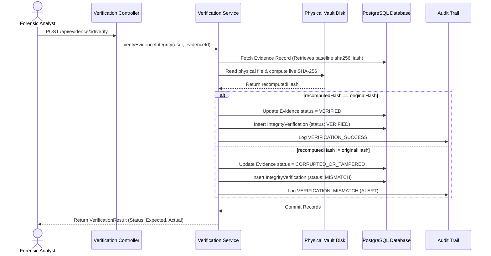

# Cryptographic Evidence Integrity & SHA-256 Verification Engine

## 1. Evidence Integrity in Digital Forensics

In digital forensics and incident response (DFIR), evidence integrity is governed by **Locard's Exchange Principle** and standards such as **ISO/IEC 27037:2012** (_Guidelines for identification, collection, acquisition and preservation of digital evidence_).

Unlike physical evidence (such as fingerprints or shell casings), digital evidence consists of volatile, abstract sequences of bits stored on electronic media. Any interaction—even booting an operating system or opening a file—can inadvertently modify access timestamps, system logs, or file contents.

To withstand legal scrutiny under rules of evidence (e.g., Federal Rules of Evidence Rule 901 or UK PACE Act 1984), forensic investigators must demonstrate that:

1. The evidence has not been altered, manipulated, or corrupted since acquisition.
2. The exact mathematical state of the artifact at registration is preserved bit-for-bit.

---

## 2. Why SHA-256 Was Chosen

ICCF utilizes the **Secure Hash Algorithm 256-bit (SHA-256)**, standardized by the National Institute of Standards and Technology (NIST) in **FIPS PUB 180-4**:

- **Collision Resistance**: The probability of finding two distinct files $M_1 \neq M_2$ such that $\text{SHA-256}(M_1) = \text{SHA-256}(M_2)$ is astronomically negligible ($\approx 2^{-128}$ operations due to the birthday attack). To date, no practical collision against SHA-256 has ever been discovered.
- **Pre-image & Second Pre-image Resistance**: Given a target digest $H$, it is computationally infeasible ($2^{256}$ operations) to find any message $M$ such that $\text{SHA-256}(M) = H$, or given $M_1$, to find $M_2$ yielding the same digest.
- **Industry & Judicial Standard**: SHA-256 is accepted by law enforcement agencies (FBI, INTERPOL, Europol) and national judiciaries as standard proof of digital evidence identity. While MD5 and SHA-1 suffer from known cryptographic collision vulnerabilities, SHA-256 remains secure.

---

## 3. Streaming Cryptographic Hash Computation

When processing files up to 50MB (or gigabytes in enterprise systems), loading the entire file into memory as a single Buffer creates severe memory pressure and Denial-of-Service risks.

ICCF calculates digests via **asynchronous stream piping**:

```typescript
import crypto from 'crypto';
import fs from 'fs';

export async function computeFileSha256(filePath: string): Promise<string> {
  return new Promise((resolve, reject) => {
    const hash = crypto.createHash('sha256');
    const stream = fs.createReadStream(filePath);

    stream.on('data', (chunk) => hash.update(chunk));
    stream.on('end', () => resolve(hash.digest('hex')));
    stream.on('error', (err) => reject(err));
  });
}
```

### Architectural Benefits:

1. **Constant Memory Footprint**: Memory consumption remains bounded (typically 64KB per chunk) regardless of file size.
2. **Backpressure Handling**: Node.js streams automatically throttle reading if hashing cannot keep pace with disk I/O.
3. **No Intermediate Files**: Data is hashed directly off disk without duplicate memory caching.

---

## 4. Dual-Hash Verification Workflow



### Key Integrity Principles:

1. **Never Overwrite Original Hash**: When a mismatch occurs, the database field `sha256Hash` (the baseline established at ingestion) is **never altered**. Overwriting the baseline would destroy the evidence of tampering.
2. **Permanent Verification Records**: Each verification attempt creates a new immutable `IntegrityVerification` row recording:
   - `expectedHash` (Original baseline digest)
   - `actualHash` (Calculated live digest)
   - `status` (`VERIFIED` or `MISMATCH`)
   - `verifiedById` (Investigator who triggered verification)
   - `verifiedAt` (Timestamp)
   - `notes` (Contextual observations)

---

## 5. What a Cryptographic Hash Proves (And What It Does Not)

### What a Match Proves:

- **Bit-Level Identity**: The file currently stored on disk contains the exact byte sequence that was present when the file was first registered in ICCF.
- **Absence of Accidental Corruption**: Bit rot, storage sector decay, transfer corruption, or unintended file modification have not occurred.

### What a Match Does NOT Prove:

- **Authenticity of Origin**: A valid hash does not prove who authored the file or that the content is truthful. (e.g., A forged document hashed properly remains a forged document).
- **Lawful Acquisition**: A hash cannot prove that evidence was collected pursuant to a lawful search warrant or within the rules of criminal procedure.
- **Time of Creation**: A hash proves the file existed at or before the time of registration in ICCF; it does not independently verify the original timestamp on the suspect's computer.

---

## 6. Incident Response to Hash Mismatches

If `POST /api/evidence/:id/verify` reports a mismatch (`CORRUPTED_OR_TAMPERED`):

1. **Status Update**: Evidence is marked with warning badge `CORRUPTED_OR_TAMPERED` across the UI.
2. **Audit Escalation**: A high-priority audit event `INTEGRITY_VERIFICATION_MISMATCH` is logged with actual and expected digests.
3. **Investigation Containment**: The file should be quarantined immediately. Forensic analysts compare filesystem timestamps, disk metadata, and server access logs to determine whether the deviation was caused by storage failure, administrative error, or active malicious tampering.
