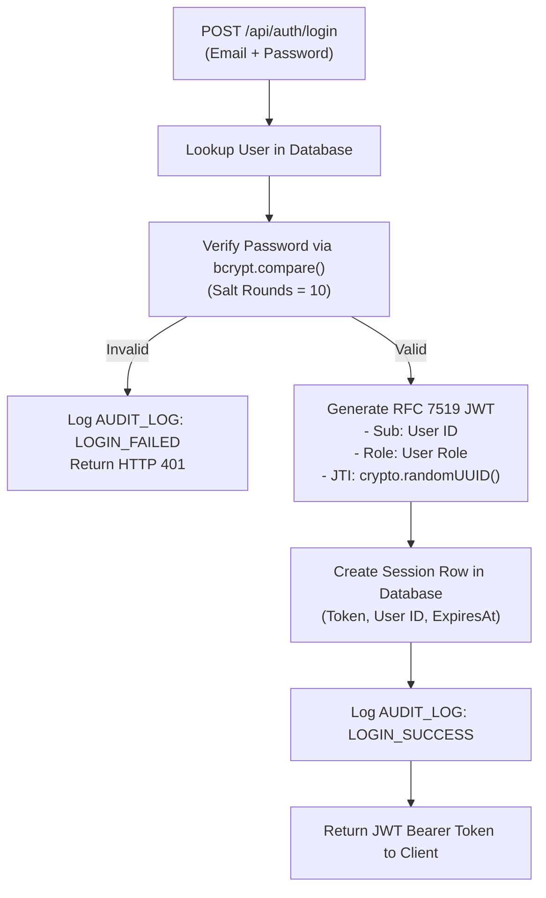

# ICCF Security Policy, Threat Model & Defense-in-Depth Architecture

## 1. Defensive Security Philosophy

The **Integrity & Chain-of-Custody Focused (ICCF)** platform is strictly an evidence preservation, digital forensics management, and chain-of-custody tracking platform.

- **Defensive By Design**: The platform contains no offensive exploitation modules, credential harvesting scripts, or automated vulnerability scanners.
- **Fail-Secure Architecture**: If any security assertion, authentication token verification, cryptographic verification, or schema validation check fails, the platform defaults to denying access (HTTP 401/403/400) and cleaning up uncommitted artifacts.
- **Zero Silent Overwrites**: In forensic software, overwriting original baselines or historical records is catastrophic. ICCF guarantees that original cryptographic hashes are never overwritten during verification runs or status updates.

---

## 2. Authentication & Session Architecture

### Password Hashing

- Passwords are encrypted using `bcryptjs` with 10 salt rounds.
- Plaintext passwords are never logged, cached, or written to disk.
- Password complexity requirements are enforced at registration via Zod: minimum 8 characters with at least one uppercase letter, one lowercase letter, one number, and one special symbol.

### JWT Token Management & Revocation

- Tokens follow RFC 7519 with standard claims: `sub` (user UUID), `email`, `role`, `iat`, `exp`, and `jti` (unique token ID generated via `crypto.randomUUID()`).
- Tokens expire after 8 hours (`JWT_EXPIRES_IN="8h"`).
- Session tracking: Each issued token is mapped to an active row in the `Session` table in PostgreSQL. When a user logs out (`POST /api/auth/logout`), the session record is deleted, rendering subsequent token presentations invalid even before expiration.

---

## 3. Role-Based Access Control (RBAC) Matrix

ICCF enforces strict role tiering across all REST API endpoints:

| Endpoint                           | Method |   ADMIN   |  INVESTIGATOR  |     VIEWER     | Unauthenticated |
| :--------------------------------- | :----: | :-------: | :------------: | :------------: | :-------------: |
| `/api/auth/register`               |  POST  |   Allow   |     Allow      |     Allow      |      Allow      |
| `/api/auth/login`                  |  POST  |   Allow   |     Allow      |     Allow      |      Allow      |
| `/api/auth/logout`                 |  POST  |   Allow   |     Allow      |     Allow      |   Deny (401)    |
| `/api/auth/me`                     |  GET   |   Allow   |     Allow      |     Allow      |   Deny (401)    |
| `/api/cases`                       |  GET   | All Cases | Assigned Cases | Assigned Cases |   Deny (401)    |
| `/api/cases`                       |  POST  |   Allow   |     Allow      |   Deny (403)   |   Deny (401)    |
| `/api/cases/:id`                   |  GET   |   Allow   | Assigned Only  | Assigned Only  |   Deny (401)    |
| `/api/cases/:id`                   | PATCH  |   Allow   | Assigned Only  |   Deny (403)   |   Deny (401)    |
| `/api/cases/:id/assign`            |  POST  |   Allow   | Assigned Only  |   Deny (403)   |   Deny (401)    |
| `/api/cases/:id/evidence`          |  GET   |   Allow   | Assigned Only  | Assigned Only  |   Deny (401)    |
| `/api/cases/:id/evidence`          |  POST  |   Allow   | Assigned Only  |   Deny (403)   |   Deny (401)    |
| `/api/evidence/:id`                |  GET   |   Allow   | Assigned Only  | Assigned Only  |   Deny (401)    |
| `/api/evidence/:id/download`       |  GET   |   Allow   | Assigned Only  | Assigned Only  |   Deny (401)    |
| `/api/evidence/:id/verify`         |  POST  |   Allow   | Assigned Only  |   Deny (403)   |   Deny (401)    |
| `/api/evidence/:id/verifications`  |  GET   |   Allow   | Assigned Only  | Assigned Only  |   Deny (401)    |
| `/api/evidence/:id/custody`        |  GET   |   Allow   | Assigned Only  | Assigned Only  |   Deny (401)    |
| `/api/evidence/:id/transfer`       |  POST  |   Allow   | Assigned Only  |   Deny (403)   |   Deny (401)    |
| `/api/evidence/:id/custody/verify` |  POST  |   Allow   | Assigned Only  | Assigned Only  |   Deny (401)    |
| `/api/audit`                       |  GET   |   Allow   |     Allow      |   Deny (403)   |   Deny (401)    |
| `/api/dashboard/summary`           |  GET   |   Allow   |     Allow      |     Allow      |   Deny (401)    |
| `/api/dashboard/activity`          |  GET   |   Allow   |     Allow      |     Allow      |   Deny (401)    |

---

## 4. Input Validation & Deep Magic-Byte Inspection

All input vectors undergo dual-tier defensive filtering:

### 1. Zod Request Schema Validation

Incoming request bodies and route parameters are validated against immutable Zod schemas before reaching controller logic. Invalid payloads are rejected with HTTP 400 Bad Request, returning detailed error trees.

### 2. Multer Limits & Extension Whitelist

- Uploads are capped at 50MB (`MAX_FILE_SIZE_BYTES=52428800`).
- Allowed file extensions: `.pdf`, `.txt`, `.csv`, `.png`, `.jpg`, `.jpeg`, `.zip`, `.pcap`, `.log`, `.raw`.
- Disallowed extensions (e.g., `.exe`, `.dll`, `.sh`, `.bat`) are immediately rejected by Multer with HTTP 400.

### 3. Deep Binary Magic-Byte Inspection

To prevent **extension spoofing** (e.g., renaming a malicious executable to `system_auth.log`), `fileValidation.ts` reads the initial 16 bytes of the binary header directly from disk:

- **Windows PE Executable**: Checks for `MZ` (`0x4D 0x5A`). If present, the file is unlinked immediately and rejected with a `Security Policy Violation` error.
- **Linux Executable**: Checks for ELF header (`0x7F 0x45 0x4C 0x46`). If present, rejected immediately.
- **Format Verification**: Checks that `.pdf` contains `%PDF-` (`0x25 0x50 0x44 0x46`), `.png` contains `0x89 'PNG'`, and `.jpg` contains `0xFF 0xD8 0xFF`.

---

## 5. File Storage Security & Vault Isolation

1. **Path Traversal Protection**: Evidence files are stored on disk under randomly generated UUIDs (e.g., `crypto.randomUUID() + safeExt`). Client-supplied filenames are never used for disk persistence, completely eliminating `../` traversal vulnerabilities.
2. **Webroot Isolation**: Storage is hosted in `./storage/evidence/`, completely external to any static web-serving root. Direct HTTP access is impossible.
3. **Authorized Streaming Downloads**: Evidence files can only be accessed via `GET /api/evidence/:id/download`. The endpoint verifies case assignment permissions, sets `Content-Disposition: attachment; filename="..."`, streams the file, and automatically appends an `EVIDENCE_DOWNLOADED` custody event to the immutable ledger.

---

## 6. Rate Limiting & Denial-of-Service Defense

ICCF configures `express-rate-limit` to mitigate brute-force credential stuffing and DoS attacks:

- **Global API Rate Limiter**: Maximum 1,000 requests per 15-minute window per IP address.
- **Authentication Rate Limiter**: Maximum 20 authentication attempts per 15-minute window per IP on `/api/auth/login` and `/api/auth/register`. Exceeding limits triggers HTTP 429 Too Many Requests.
- **Helmet Headers**: Configures security headers including `Content-Security-Policy`, `X-Frame-Options: DENY`, `X-Content-Type-Options: nosniff`, and `Strict-Transport-Security`.
- **CORS Restrictions**: Constrained strictly to `FRONTEND_URL` (`http://localhost:5173`).

---

## 7. Audit Logging Architecture

Security-critical operations trigger automated records in the `AuditLog` table:

- **Recorded Attributes**:
  - `userId` (Actor UUID)
  - `action` (e.g., `LOGIN_SUCCESS`, `EVIDENCE_UPLOAD`, `CUSTODY_TRANSFER`, `INTEGRITY_VERIFICATION`)
  - `entityType` (`CASE`, `EVIDENCE`, `USER`, `CUSTODY`)
  - `entityId` (Target record UUID)
  - `outcome` (`SUCCESS`, `FAILURE`, `DENIED`)
  - `ipAddress` (Client IP)
  - `userAgent` (Client browser or tool user-agent)
  - `details` (Contextual JSON metadata)
  - `timestamp` (UTC ISO timestamp)
- **Immutability**: The audit log has no update or delete routes in the API. It serves as an immutable forensic record of system activity.

---

## 8. Known Limitations & Accepted Risks

1. **Database Administrator (DBA) Access**: ICCF provides application-level tamper evidence. An attacker with root PostgreSQL privileges could modify database rows and re-calculate forward hash pointers. To reach military/courtroom-grade immutability, this should be paired with Write-Once-Read-Many (WORM) hardware storage, PKCS#11 HSM signing, or external RFC 3161 Time-Stamp Authorities.
2. **TLS Termination**: In local development, traffic runs over HTTP. In production deployment, reverse proxies (e.g., NGINX, Cloudflare) must provide TLS 1.3 termination.
3. **File Size Ceiling**: The current limit is 50MB per file to maintain responsiveness in local environments. For enterprise multiterabyte disk images (e.g., `.E01`, `.dd`), a chunked multipart streaming vault using dedicated object storage (such as MinIO or S3) would be required.
